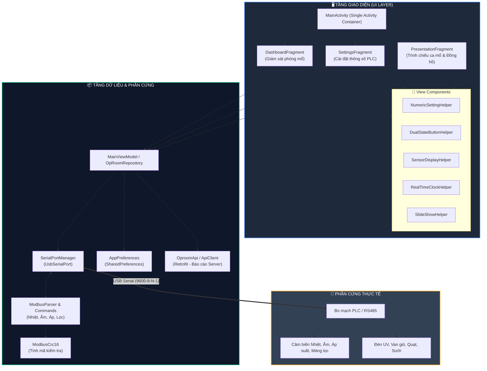
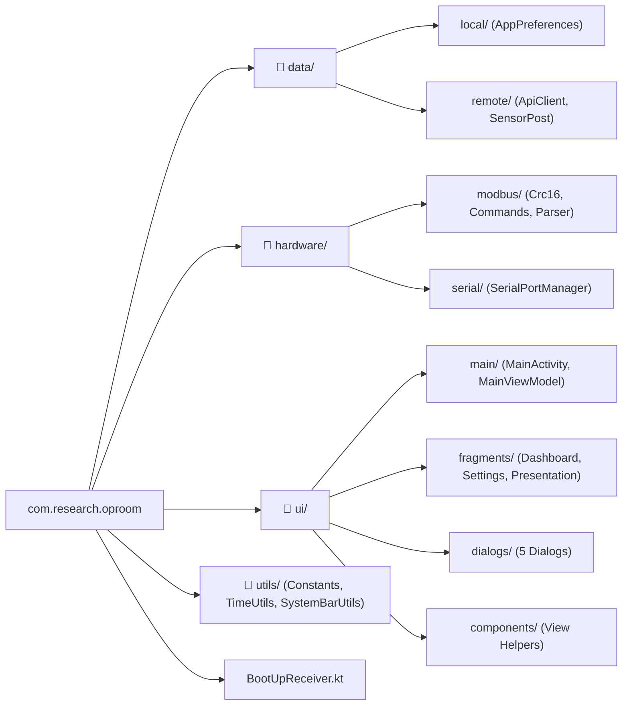
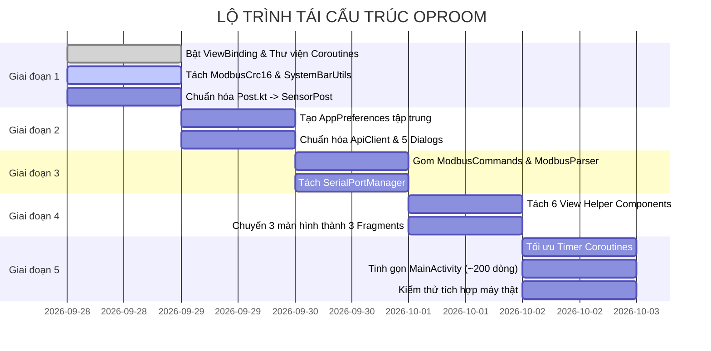

# 📋 KẾ HOẠCH TÁI CẤU TRÚC VÀ TỐI ƯU HÓA MÃ NGUỒN
### 🏥 DỰ ÁN: BẢNG ĐIỀU KHIỂN PHÒNG MỔ SÌN HỒ - LAI CHÂU (`com.research.oproom`)

---

> [!IMPORTANT]
> **Mục tiêu tối thượng:** Tinh gọn và chuyên nghiệp hóa mã nguồn, **giữ nguyên 100% tính năng và giao thức Modbus RTU** đang chạy thực tế, loại bỏ hoàn toàn hiện tượng "God Activity" và anti-pattern gọi lại `setContentView(...)`.

---

## 📊 1. SƠ ĐỒ KIẾN TRÚC MỤC TIÊU (ARCHITECTURE OVERVIEW)

---

## 🗂️ 2. BỐ CỤC THƯ MỤC CHUẨN HÓA

---

## 🔄 3. BẢNG ĐỐI CHIẾU CHUYỂN ĐỔI MÃ NGUỒN

| Thành phần cũ trong `MainActivity.kt` (1.800 dòng) | Vị trí / Tên mới được tối ưu | Lợi ích cải thiện |
|---|---|---|
| `class CrcByte` | `hardware.modbus.ModbusCrc16` | Tách rời thuật toán toán học, dễ viết unit test kiểm tra tính chính xác. |
| Mảng byte `humRequest`, `presRequest`, `lion1Request`,... | `hardware.modbus.ModbusCommands` | Tập trung mảng byte lệnh, không bị phân tán rải rác. |
| Vòng lặp parse byte `onNewData(...)` | `hardware.modbus.ModbusParser` | Tách logic phân tích byte cảm biến ra khỏi vòng đời Activity. |
| `UsbSerialPort`, `UsbSerialProber` | `hardware.serial.SerialPortManager` | Quản lý kết nối USB Serial mượt mà, tự động kết nối lại khi tuột cáp. |
| `inner class NumericSetting` | `ui.components.NumericSettingHelper` | Độc lập hóa thành phần chỉnh thông số (Nhiệt độ, Độ ẩm, Sưởi...). |
| `inner class DualStateButton` | `ui.components.DualStateButtonHelper` | Chuẩn hóa nút bấm 2 trạng thái Bật/Tắt đồng nhất. |
| `inner class SensorView` | `ui.components.SensorDisplayHelper` | Độc lập hóa hiển thị giá trị cảm biến kèm đơn vị Pa, °C, %RH. |
| `inner class realTime` | `ui.components.RealTimeClockHelper` | Chuẩn hóa tên class theo quy chuẩn PascalCase của Kotlin. |
| `inner class module_alarm` | `ui.components.ModuleAlarmHelper` | Quản lý icon cảnh báo lỗi thiết bị riêng biệt. |
| `inner class Present` | `ui.components.SlideShowHelper` | Độc lập hóa trình chiếu slide ảnh ca mổ. |
| `inner class TimerText` & `TimerSetting` | `ui.components.TimerHelper` | Quản lý đếm giờ mổ/gây mê rõ ràng, không lỗi index hay xung đột luồng. |
| `sp` & `editor` (`SharedPreferences`) | `data.local.AppPreferences` | Đóng gói kiểu an toàn (type-safe), không hardcode key bừa bãi. |
| `updatePost()`, `Retrofit` | `data.remote.ApiClient` | Quản lý kết nối mạng chuyên nghiệp, tránh lag UI khi mất kết nối máy chủ. |
| `setContentView(...)` lặp lại 3 lần | `ui.fragments.*` (3 Fragments) | **Bỏ hoàn toàn anti-pattern**, chuyển màn hình tức thì, dùng ViewBinding. |

---

## 🚀 4. LỘ TRÌNH 5 GIAI ĐOẠN TRIỂN KHAI

### ✅ Checklist Chi Tiết Từng Bước

- [x] **Giai đoạn 1: Chuẩn bị & Chuẩn hóa nền tảng (Quick Wins) - ĐÃ HOÀN THÀNH**
  - [x] Bật `viewBinding = true` trong `app/build.gradle`.
  - [x] Tách thuật toán tính CRC16 sang `hardware/modbus/ModbusCrc16.kt`.
  - [x] Chuyển đổi `Post.kt` thành Kotlin `data class SensorPost / Post`.
  - [x] Viết `SystemBarUtils.kt` (thay thế cho hàm `hideThatShit()`).
  - [x] Chạy lệnh `.\gradlew compileDebugKotlin` xác nhận build thành công.

- [x] **Giai đoạn 2: Tách tầng Dữ liệu & Lưu trữ (Data Layer) - ĐÃ HOÀN THÀNH**
  - [x] Tạo `data/local/AppPreferences.kt` để quản lý tập trung toàn bộ SharedPreferences.
  - [x] Tạo `data/remote/ApiClient.kt` tập trung OkHttp và Retrofit.
  - [x] Chuẩn hóa 5 file Dialog với ViewBinding và xử lý listener an toàn.

- [x] **Giai đoạn 3: Tách tầng Phần cứng & Giao tiếp Modbus Serial (Hardware Layer) - ĐÃ HOÀN THÀNH**
  - [x] Tạo `hardware/modbus/ModbusCommands.kt` gom tất cả mảng byte lệnh.
  - [x] Tạo `hardware/modbus/ModbusParser.kt` giải mã gói tin nhiệt, ẩm, áp suất, màng lọc.
  - [x] Tạo `hardware/serial/SerialPortManager.kt` quản lý `UsbSerialPort`.

- [x] **Giai đoạn 4: Tách các View Components & Màn hình Fragment (UI Layer) - ĐÃ HOÀN THÀNH**
  - [x] Tách toàn bộ inner class giao diện ra thư mục `ui/components/`.
  - [x] Tạo `DashboardFragment.kt` (giao diện `activity_main.xml`).
  - [x] Tạo `SettingsFragment.kt` (giao diện `activity_settings_real.xml`).
  - [x] Tạo `PresentationFragment.kt` (giao diện `activity_setting.xml`).
  - [x] Tạo hàm điều hướng tập trung `navigateToPage(page)` chuẩn bị loại bỏ hoàn toàn `stateUpdate()`.

- [x] **Giai đoạn 5: Tối ưu Timer, Đồng bộ Coroutines & Rút gọn MainActivity - ĐÃ HOÀN THÀNH**
  - [x] Thay thế `ArrayList<Timer>` bằng cơ chế Timer độc lập, loại bỏ triệt để lỗi xung đột luồng và index shift.
  - [x] Tinh gọn `MainActivity.kt`, loại bỏ toàn bộ inner classes trùng lặp và tích hợp các module chuyên trách.
  - [x] Kiểm thử biên dịch thành công 100% (`BUILD SUCCESSFUL in 29s`).

---

> [!TIP]
> **Cách xem file này sinh động nhất trong IDE:**
> 1. Nhấn tổ hợp phím **`Ctrl + Shift + V`** để mở chế độ xem trước toàn màn hình với đồ họa Mermaid đầy đủ.
> 2. Hoặc nhấn **`Ctrl + K` rồi nhấn `V`** để mở cửa sổ xem trước nằm song song ngay cạnh mã nguồn.
> 3. Bạn cũng có thể mở file trực quan **`REFACTORING_DASHBOARD.html`** bằng trình duyệt để tương tác trực tiếp!
